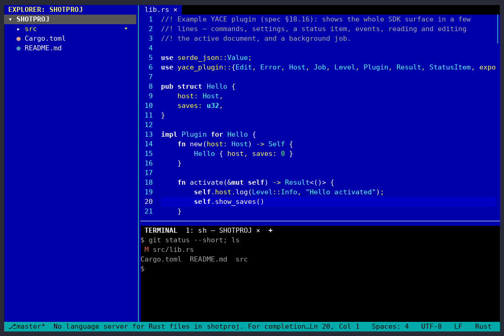
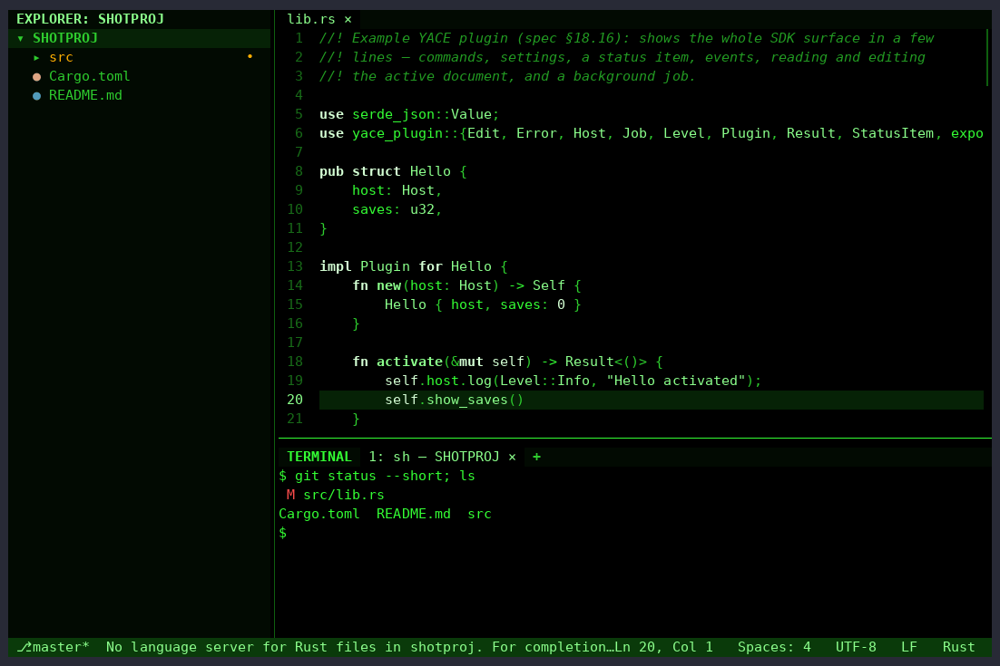
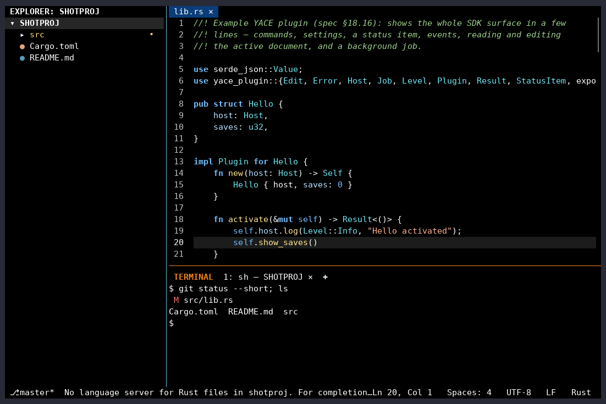
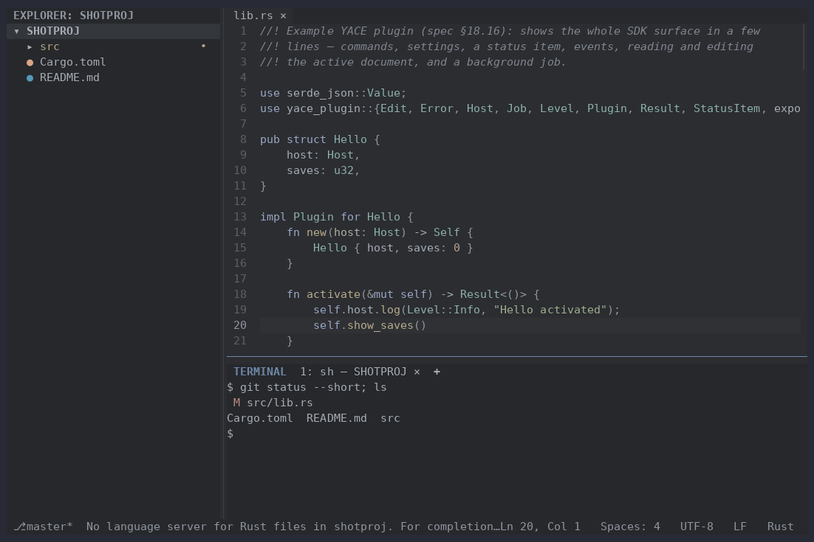

# YACE Themes

Four colour themes for [YACE](https://github.com/abedmurrar/yace), the
terminal code editor with VS Code's keys:

| Theme | |
|---|---|
| **Retro Blue** | the blue-screen IDEs of the DOS years: yellow and white text on blue, cyan bars, grey dialogs, in the 16-colour CGA palette |
| **Phosphor** | a green phosphor monitor: green on black. Errors and deleted files stay red and warnings amber, so problems still stand out |
| **High Contrast** | black and white with bright accents. Every text colour is at least 7:1 against its background (WCAG AAA) |
| **Low Contrast** | soft and muted for long sessions. No pure white, no saturated colours; text stays readable (4.5:1 to 7:1) |

Every theme colours the whole interface (Explorer, tabs, status bar,
pickers, terminal and its 16 ANSI colours) and the code. The pack is data
only: it contains no code, so nothing runs when you install it.

## Retro Blue



## Phosphor



## High Contrast



## Low Contrast



## Install

Needs YACE 0.11 or later.

```sh
curl -fsSLO https://github.com/abedmurrar/yace-themes/releases/latest/download/yace-themes.tar.gz
yace --install-plugin yace-themes.tar.gz
```

Or in YACE: **Extensions: Install from Package…** and choose the
downloaded file. Then pick a theme with `Ctrl+K Ctrl+T` (Preferences:
Color Theme), or set it in `~/.config/yace/config.toml`:

```toml
[workbench]
colorTheme = "Retro Blue"
```

To change a few colours of a theme, use `workbench.colorCustomizations`
([YACE theme docs](https://abedmurrar.github.io/yace/docs/themes.html)).

## Contrast

`scripts/check_themes.py` checks every theme before each release:
- it sets every colour key, so nothing falls back to another theme
- its text meets the contrast it promises (WCAG 2 ratios), in the editor,
  the side bar, tabs, the status bar, pickers, the terminal, and on the
  selection

| Theme | Editor text | Text minimum | Comments minimum |
|---|---|---|---|
| Retro Blue | 12.5:1 | 4.5:1 | 4.5:1 |
| Phosphor | 15.5:1 | 4.5:1 | 3:1 |
| High Contrast | 21:1 | 7:1 | 7:1 |
| Low Contrast | 6.1:1 | 4.5:1 (at most 7:1) | 3:1 |

## Development

```sh
python3 scripts/check_themes.py   # contrast and completeness
scripts/package.sh                # dist/yace-themes-<version>.tar.gz (needs yace)
```

Edit the files in `themes/` (the format is in the
[YACE theme docs](https://abedmurrar.github.io/yace/docs/themes.html)).
While editing, copy a theme into `~/.config/yace/themes/`: YACE applies
it again every time you save.

To release: bump `version` in `yace-plugin.toml`, commit, and push a tag
`vX.Y.Z`. The release workflow checks the themes, packages them and
publishes the package with its SHA-256.

## Licence

MIT or Apache-2.0, at your option.
